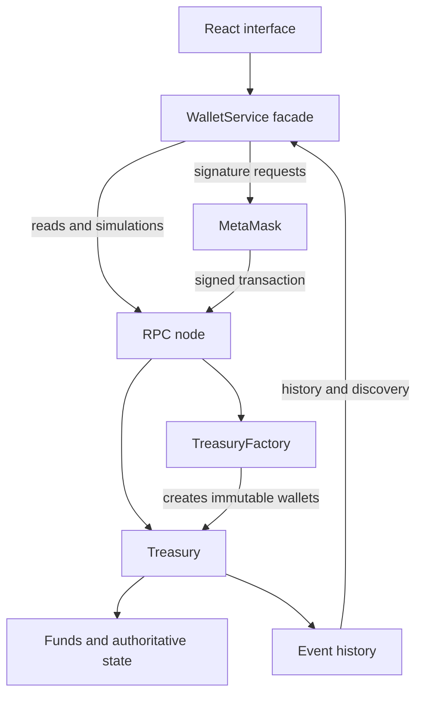
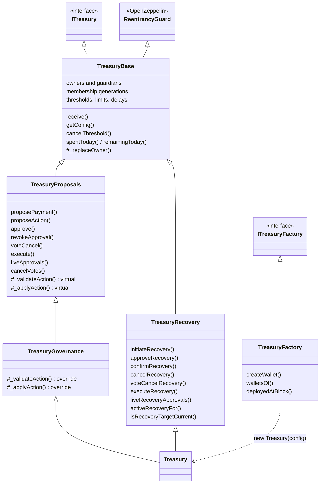
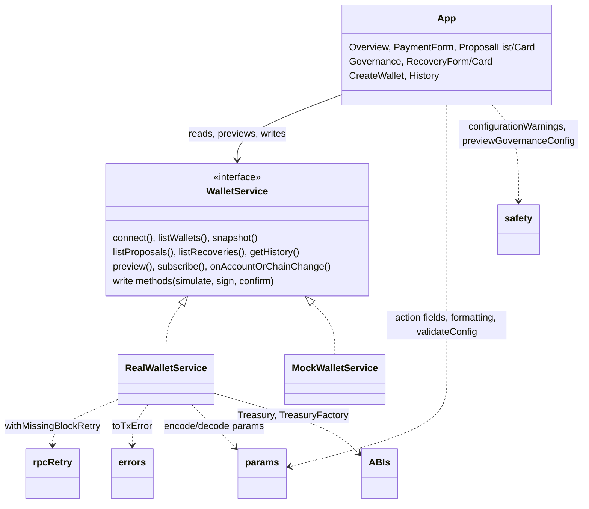
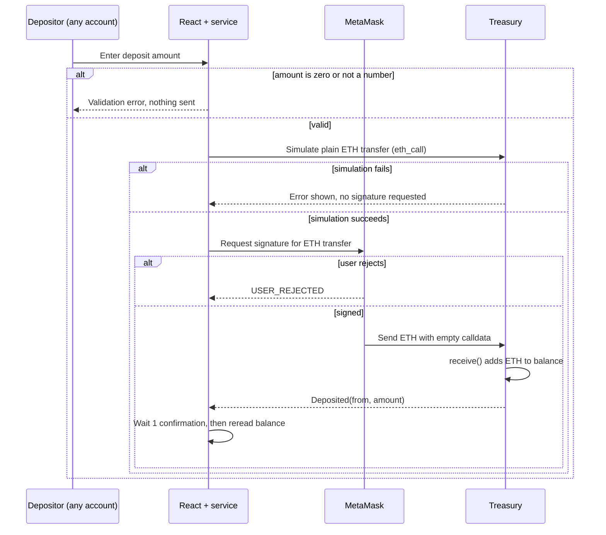
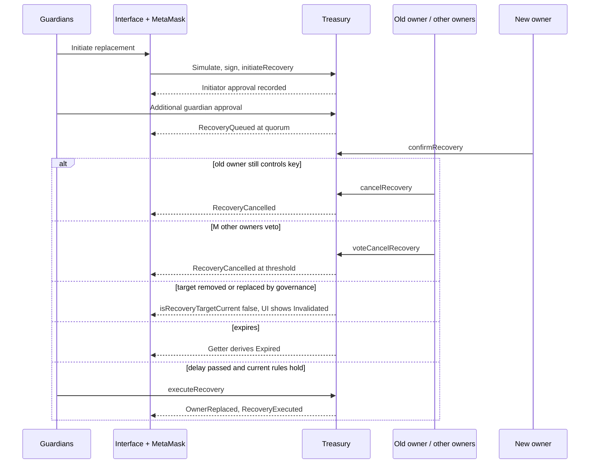
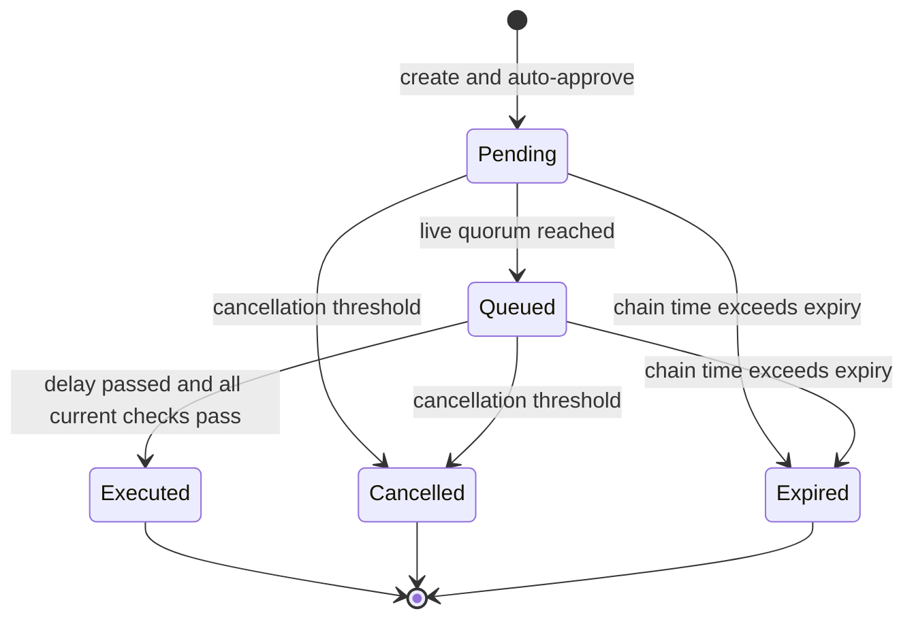
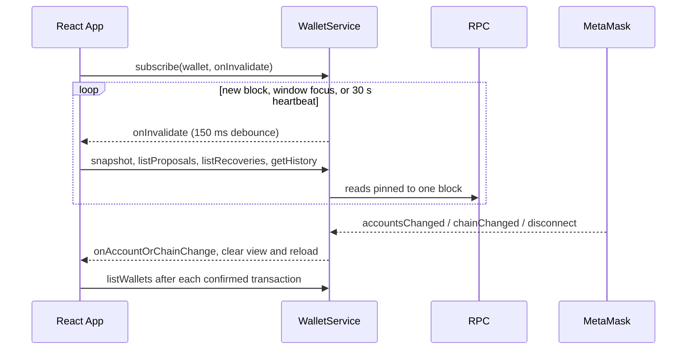
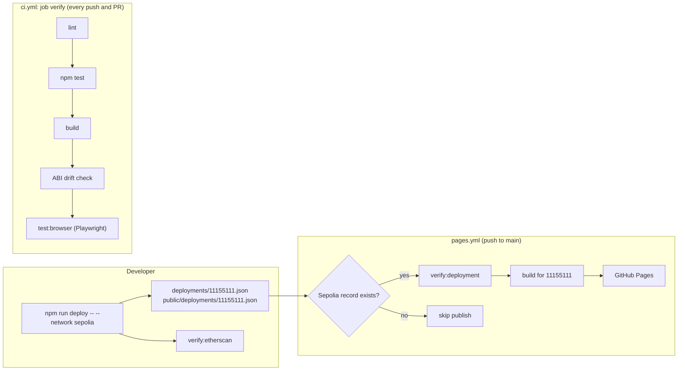

# Architecture and UML — Milestone 4

The browser uses a React interface and a WalletService facade. Components request reads,
previews and writes through the service, which hides ethers.js and provider details.
Public state reads use RPC; writes require the connected MetaMask account's signature.
The browser never receives private keys. The contract remains authoritative even if a
modified frontend hides rules or bypasses client-side validation.

A factory creates independent immutable treasury contracts. Each treasury stores members,
limits, approvals, proposals and recovery state. New blocks, window focus, account/chain
changes and a slow heartbeat invalidate the UI's cached reads; state is then reread from
the chain at one block rather than rebuilt from events. Events supply transaction history
and wallet discovery only. Browser local storage holds wallet addresses only (created,
manually added, or the deployment's demo wallet), keyed per chain.

The same build targets a local Ganache chain (chain ID 1337) and Sepolia (11155111). The
Sepolia frontend is published to GitHub Pages; contracts are deployed manually.

## Contract class structure

All classes below are implemented. There is no proxy or initialize/upgradeTo entry point.

`TreasuryProposals` declares the action hooks and reverts `InvalidAction` by default;
`TreasuryGovernance` implements them for the nine non-payment action types. Governance
`ReplaceOwner` and guardian recovery both end in the shared `_replaceOwner` helper.

## Frontend module structure

`createWalletService` in `src/services/index.js` returns the mock when `VITE_USE_MOCK=true`.
Components never import ethers or ABI files. `walletService.types.js` documents the
boundary, including the UI-only `Ready` and `Invalidated` view statuses.

## Deposit sequence

Deposits are plain ETH transfers handled by `receive()`, not a proposal. Anyone can
deposit: no role check, approval, timelock or cap applies. Only spending ETH out needs
owner approval.

## Payment sequence

```mermaid
sequenceDiagram
  participant Owner
  participant UI as React + service
  participant MM as MetaMask
  participant T as Treasury
  participant R as Recipient
  Owner->>UI: Enter payment
  UI->>T: Simulate proposePayment
  alt invalid recipient or amount
    T-->>UI: Custom error
  else valid
    UI->>MM: Request signature
    MM->>T: proposePayment
    T-->>UI: ProposalCreated, Approved
    Owner->>UI: Other owners approve using their accounts
    UI->>MM: Sign approvals
    MM->>T: approve
    T-->>UI: Queued when quorum reached
    Owner->>UI: Execute after delay
    UI->>T: Simulate execute
    alt delay, expiry, quorum, caps or balance fail
      T-->>UI: Custom error
    else current rules pass
      UI->>MM: Request execution signature
      MM->>T: execute
      T->>R: Transfer ETH
      alt recipient rejects
        T-->>UI: TransferFailed&#59; revert all effects
      else succeeds
        T-->>UI: PaymentSent, Executed
      end
    end
  end
```

## Recovery sequence

The new owner may also execute recovery. Execution requires the new owner's confirmation
(`NewOwnerNotConfirmed` otherwise). Guardians never transfer funds or directly change
thresholds, limits, or other guardians.

## State machines

Proposals and recoveries use independent arrays, vote mappings and timers with this shape.
Recovery additionally requires confirmation by the replacement address and supports direct
target cancellation. Ready is a UI label for Queued with a completed timelock, not a stored
status. Invalidated is a UI label for an active recovery whose target is no longer the
current owner generation. Expired is also derived. Failed execution leaves the preceding
state unchanged.

## Data freshness

- Every wallet event lands in a new block, so the block subscription alone triggers
  refreshes; there is no separate log filter. The heartbeat is a 30 s fallback for stalled
  block polling. Sepolia polls every 4 s, Ganache every 2 s.
- Reads in one refresh are pinned to a single block. `getCode` and `getConfig` are cached
  per wallet and block hash, so a snapshot and both lists share one read.
- The provider uses `staticNetwork`; the RPC chain ID is checked once and MetaMask's chain
  on each write (`WRONG_NETWORK` on mismatch).
- `rpcRetry.js` retries only `block not found` / `header not found` errors (up to 4
  attempts with backoff). Load-balanced public RPCs can route a read pinned to the newest
  block to a node that has not imported it yet.
- Because state is reread rather than replayed from events, events missed while offline
  are recovered on the next block, focus or reconnect.

## Deployment and CI

- CI holds no keys and sends no transactions. Contract deployment is a manual, one-time
  command (see DECISIONS.md and the README's Public deployment section).
- `verify:deployment` compares the deployed runtime bytecode with the current build,
  checks the deployment record and wallet provenance, and confirms Etherscan source
  verification when `ETHERSCAN_API_KEY` is set. A mismatch blocks publishing.
- The current Sepolia record lists the factory, its deployment block (used as the
  discovery scan start) and a demo wallet. Contracts are immutable: any Solidity change
  requires a redeploy and new records.

## Design rationale

| Choice | Problem solved | Trade-off |
| --- | --- | --- |
| Immutable wallet | Avoid privileged upgrade authority and initializer bugs | Fixes require new deployment and governed fund transfer |
| Live, generation-aware approvals | Removed/replaced/rejoined accounts must not retain stale voting power | Iterates at most 20 current members |
| Separate guardian state machine | Recover lost access without granting guardians spending rights | Longer delay, cancellation monitoring and new-account confirmation |
| WalletService facade | Keep RPC, ABI decoding and signing out of components | Additional abstraction and integration tests |
| Blocks invalidate, storage reads are authoritative | Recover from missed events and reconnects | More RPC reads per block; large histories eventually need indexing |
| Typed governance actions | Prevent arbitrary call execution and enable readable previews | Adding action types requires a new immutable implementation |
| Warnings instead of minimum thresholds | Keep the specification's valid configurations (M=1, K=1, M=N, K=G) | Protection relies on users reading frontend warnings |
| Manual deploy, automated verification | CI never holds a deployer key | Deployment depends on one maintainer committing the records |

## Milestone 4 semantics and interfaces

### Pending and queued requests under governance changes

Proposals and recoveries start Pending. The proposer/initiator auto-approves; `_queue`
or `_queueRecovery` runs when creating a request or receiving another approval. It
starts the timer only on the first Pending-to-Queued transition. Lowering a threshold
alone does not queue existing Pending requests; an approval transaction must trigger
that transition. A pending owner approval can be revoked and cast again if necessary.

Once Queued, a request stays Queued even if membership/threshold changes reduce its live
quorum. Execution rechecks current quorum. Restoring quorum never restarts the original
readyAt: once the original delay has elapsed, execution can proceed immediately subject
to expiry and all other checks. Queued owner approvals cannot be revoked; cancellation
is the available veto. Delay changes and spending-tier changes do not retroactively
recompute readyAt. This preserves the original queued delay rather than promising a new
monitoring window whenever quorum changes.

Payments recheck the current per-payment/daily caps and balance at execution; governance
revalidates action parameters against current membership/configuration. Cancellation
counts current generation-aware votes against the current threshold. Threshold changes
alone do not finalize cancellation: another valid cancellation vote triggers the check.

**Known limitation (deployed contracts):** `execute()` and `executeRecovery()` do not
check cancellation votes. The cancel threshold (`owners - threshold + 1` for proposals,
`threshold` for recoveries) can drop below the votes already cast, when M is raised or an
owner is removed. The request then stays Queued and remains executable until another
owner casts a cancel vote. If every remaining owner has already voted, nobody can cast
that vote, so the veto can never be finalized. Example: 3 owners with M=1 means cancelling
needs 3 votes. A and B vote; governance removes C. Cancelling now needs 2, and A and B
already have 2, but `AlreadyVoted` prevents re-voting. Any owner can still execute the
payment. The fix is to make execution revert (or mark the request Cancelled) when
`cancelVotes(id) >= cancelThreshold()`. It changes runtime bytecode, so it needs a Sepolia
redeploy (`verify:deployment` blocks Pages publishing until then) and is deferred to that
redeploy. Until then, owners who want a veto should vote before any membership or
threshold change executes.

Expiry remains fixed from request creation, including when proposal/recovery TTL changes.

### Recovery validity and presentation

`isRecoveryTargetCurrent(id)` checks both owner membership and the captured generation.
A removed-and-readded address therefore cannot revive a stale recovery. The service uses
this view to label active stale requests Invalidated without changing Solidity enum
values or stored statuses. It exposes `contractStatus` and `blockedReason`; the UI keeps
cancellation available but disables approval/confirmation/execution of invalidated requests.
Terminal Executed/Cancelled/Expired statuses remain unchanged. A new-owner membership
conflict is explained separately because it may be resolved by later governance.
Invalidation does not clear address reservations: cancel or wait for expiry before reuse.

Generation changes invalidate old approvals and cancellation votes for both owner and
guardian roles. The mock marks recovery targets invalid when owner membership is removed
or replaced and exposes the same display fields; it remains a UI fixture, not an EVM clone.

### Discovery

The factory's `walletsOf` index is historical. The service scans WalletCreated events
from the factory's deployment block (taken from the deployment record when present), then
checks current owner/guardian roles in parallel at a common block. Members added through
governance or recovery can therefore discover wallets without local storage. Discovery
reruns on account or wallet change and after each confirmed transaction, not on every
block.

Factory and wallet-history scans are incremental: each fetches only new blocks and rereads
the last 5 in case of a shallow reorganization. Scan results and deployment blocks are
held in memory, so each page load scans from deployment once. Other-factory wallets require
manual address entry. A cache that persists across page loads, deep-reorg handling and a
production indexer are deferred.

### Risk guidance

Warnings on creation, overview, recovery and governance previews explain M=1 (one owner
can authorize everything), K=1 (one guardian can authorize recovery), M=N (no possible
M-other-owner veto) and K=G (no spare guardian). Loss of guardian quorum requires owner
governance while an owner quorum is still available. A stolen target key can veto guardian
recovery, so a remaining owner quorum must replace that address through governance. There
is no bypass if both quorums become inaccessible. The interface cannot detect whether a
private key is actually lost; it explains the limits without claiming an unavailable-key
detector or adding a privileged administrator.

Configuration warnings evaluate the proposed configuration (`previewGovernanceConfig`) for
AddOwner, RemoveOwner, ReplaceOwner, AddGuardian, RemoveGuardian and threshold changes, so
a removal that makes M=N or K=G warns before signing. These are UI previews; contract
validation remains authoritative.

Security scenarios and their tests are listed in SECURITY_SCENARIOS_M4.md; trade-offs and
remaining risks are in TRADEOFFS_RISKS_M4.md.
