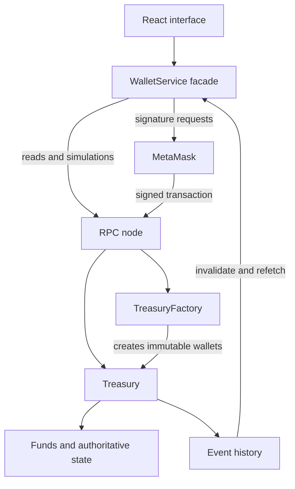
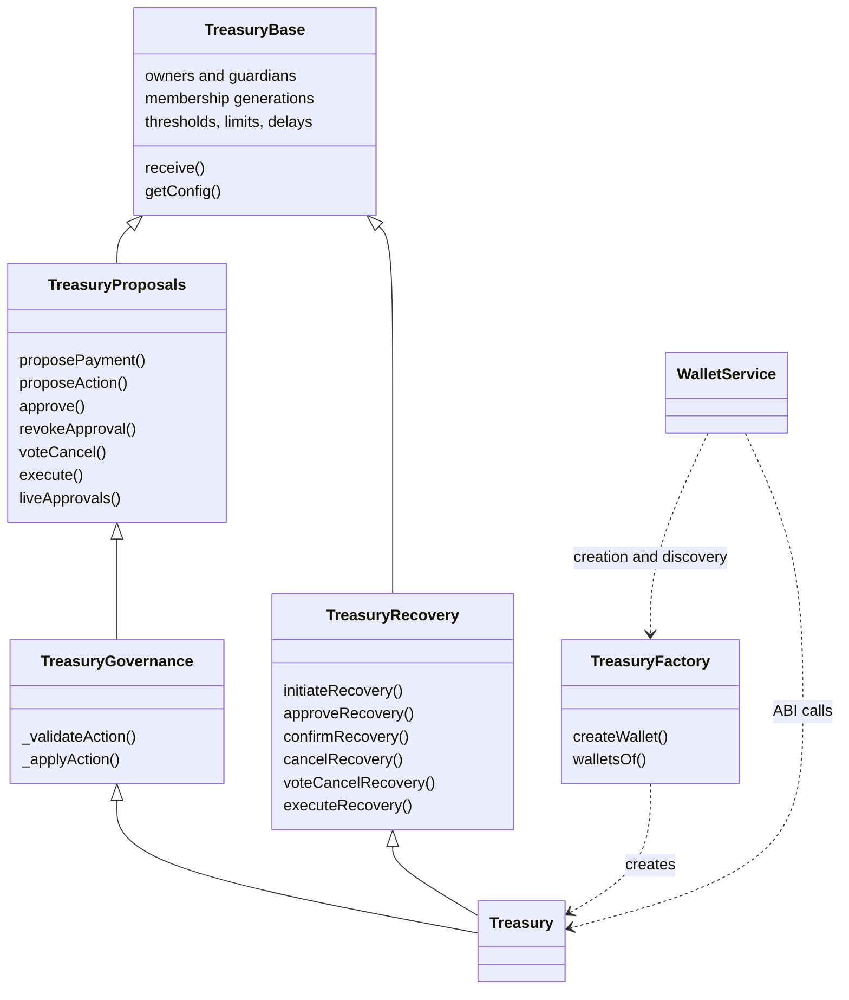
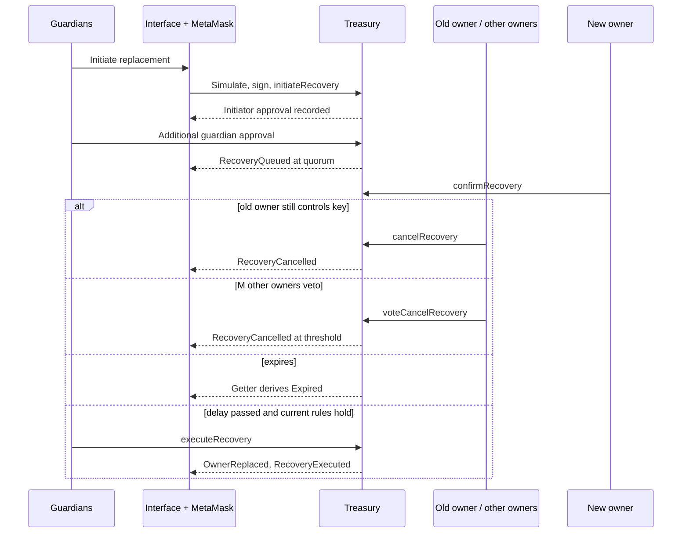
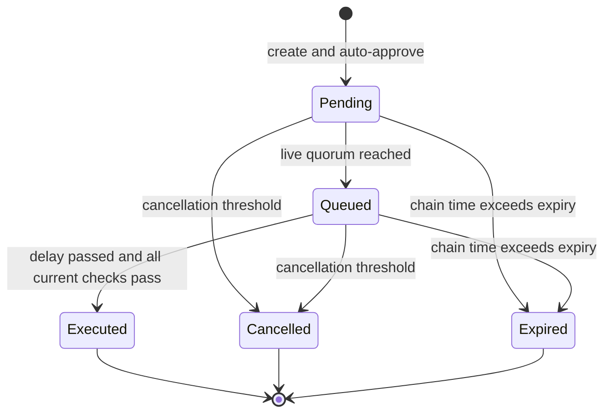

# Architecture and UML — implemented MVP

The browser uses a React interface and a WalletService facade. Components request reads,
previews and writes through the service, which hides ethers.js and provider details.
Public state reads use RPC; writes require the connected MetaMask account's signature.
The browser never receives private keys. The contract remains authoritative even if a
modified frontend hides rules or bypasses client-side validation.

A factory creates independent immutable treasury contracts. Each treasury stores members,
limits, approvals, proposals and recovery state. Events supply transaction history and
invalidate the UI's cached reads. State is always reread from the chain rather than rebuilt
solely from events. Browser local storage contains manually added wallet addresses only.



## Class structure

All classes below are implemented. There is no proxy or initialize/upgradeTo entry point.



## Payment sequence

```mermaid
sequenceDiagram
  participant Owner
  participant UI as React + service
  participant MM as MetaMask
  participant T as Treasury
  participant R as Recipient
  Owner->>UI: Enter payment
  UI->>T: Simulate proposePayment
  alt invalid recipient or amount
    T-->>UI: Custom error
  else valid
    UI->>MM: Request signature
    MM->>T: proposePayment
    T-->>UI: ProposalCreated, Approved
    Owner->>UI: Other owners approve using their accounts
    UI->>MM: Sign approvals
    MM->>T: approve
    T-->>UI: Queued when quorum reached
    Owner->>UI: Execute after delay
    UI->>T: Simulate execute
    alt delay, expiry, quorum, caps or balance fail
      T-->>UI: Custom error
    else current rules pass
      UI->>MM: Request execution signature
      MM->>T: execute
      T->>R: Transfer ETH
      alt recipient rejects
        T-->>UI: TransferFailed; revert all effects
      else succeeds
        T-->>UI: PaymentSent, Executed
      end
    end
  end
```

## Recovery sequence



The new owner may also execute recovery. Guardians never transfer funds or directly change
thresholds, limits, or other guardians.

## State machines



Proposals and recoveries use independent arrays, vote mappings and timers with this shape.
Recovery additionally requires confirmation by the replacement address and supports direct
target cancellation. Ready is a UI label for Queued with a completed timelock, not a stored
status. Expired is also derived. Failed execution leaves the preceding state unchanged.

## Design rationale

| Choice | Problem solved | Trade-off |
| --- | --- | --- |
| Immutable wallet | Avoid privileged upgrade authority and initializer bugs | Fixes require new deployment and governed fund transfer |
| Live, generation-aware approvals | Removed/replaced/rejoined accounts must not retain stale voting power | Iterates at most 20 current members |
| Separate guardian state machine | Recover lost access without granting guardians spending rights | Longer delay, cancellation monitoring and new-account confirmation |
| WalletService facade | Keep RPC, ABI decoding and signing out of components | Additional abstraction and integration tests |
| Events invalidate storage reads | Recover from missed events and reconnects | More RPC reads; large histories eventually need indexing |
| Typed governance actions | Prevent arbitrary call execution and enable readable previews | Adding action types requires a new immutable implementation |
