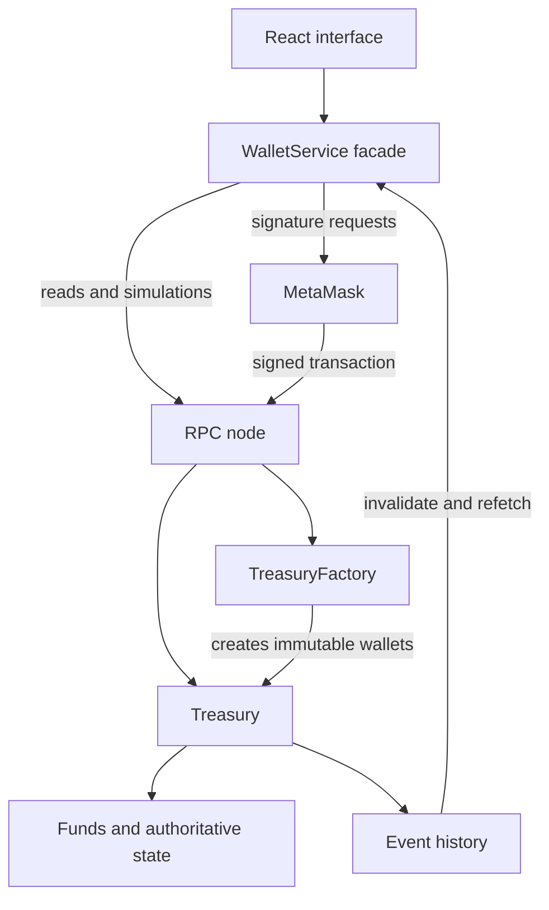
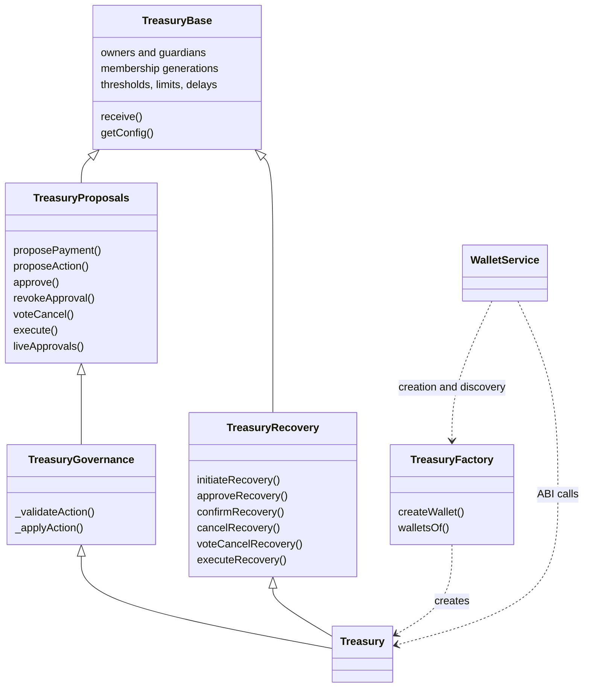
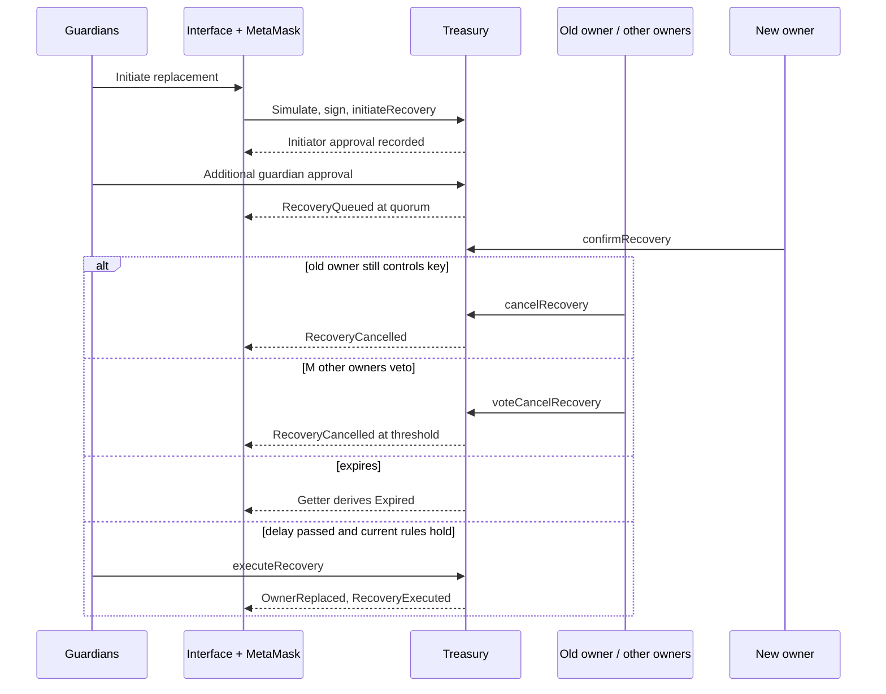
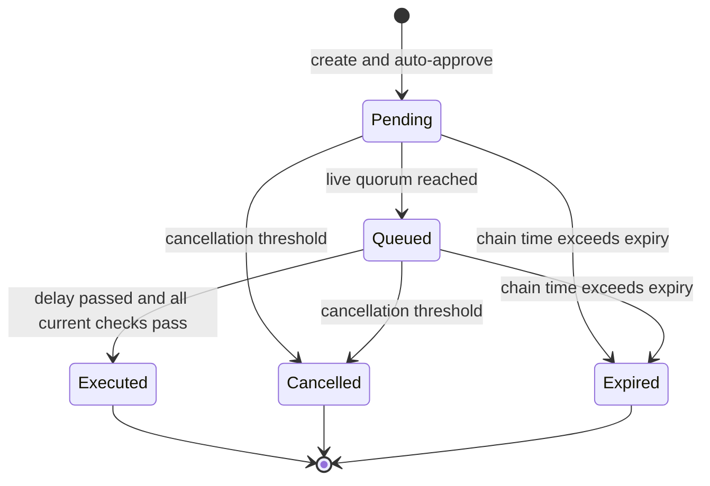

# Architecture and UML — implemented MVP

The browser uses a React interface and a WalletService facade. Components request reads,
previews and writes through the service, which hides ethers.js and provider details.
Public state reads use RPC; writes require the connected MetaMask account's signature.
The browser never receives private keys. The contract remains authoritative even if a
modified frontend hides rules or bypasses client-side validation.

A factory creates independent immutable treasury contracts. Each treasury stores members,
limits, approvals, proposals and recovery state. Events supply transaction history and
invalidate the UI's cached reads. State is always reread from the chain rather than rebuilt
solely from events. Browser local storage contains manually added wallet addresses only.



## Class structure

All classes below are implemented. There is no proxy or initialize/upgradeTo entry point.



## Payment sequence

```mermaid
sequenceDiagram
  participant Owner
  participant UI as React + service
  participant MM as MetaMask
  participant T as Treasury
  participant R as Recipient
  Owner->>UI: Enter payment
  UI->>T: Simulate proposePayment
  alt invalid recipient or amount
    T-->>UI: Custom error
  else valid
    UI->>MM: Request signature
    MM->>T: proposePayment
    T-->>UI: ProposalCreated, Approved
    Owner->>UI: Other owners approve using their accounts
    UI->>MM: Sign approvals
    MM->>T: approve
    T-->>UI: Queued when quorum reached
    Owner->>UI: Execute after delay
    UI->>T: Simulate execute
    alt delay, expiry, quorum, caps or balance fail
      T-->>UI: Custom error
    else current rules pass
      UI->>MM: Request execution signature
      MM->>T: execute
      T->>R: Transfer ETH
      alt recipient rejects
        T-->>UI: TransferFailed; revert all effects
      else succeeds
        T-->>UI: PaymentSent, Executed
      end
    end
  end
```

## Recovery sequence



The new owner may also execute recovery. Guardians never transfer funds or directly change
thresholds, limits, or other guardians.

## State machines



Proposals and recoveries use independent arrays, vote mappings and timers with this shape.
Recovery additionally requires confirmation by the replacement address and supports direct
target cancellation. Ready is a UI label for Queued with a completed timelock, not a stored
status. Expired is also derived. Failed execution leaves the preceding state unchanged.

## Design rationale

| Choice | Problem solved | Trade-off |
| --- | --- | --- |
| Immutable wallet | Avoid privileged upgrade authority and initializer bugs | Fixes require new deployment and governed fund transfer |
| Live, generation-aware approvals | Removed/replaced/rejoined accounts must not retain stale voting power | Iterates at most 20 current members |
| Separate guardian state machine | Recover lost access without granting guardians spending rights | Longer delay, cancellation monitoring and new-account confirmation |
| WalletService facade | Keep RPC, ABI decoding and signing out of components | Additional abstraction and integration tests |
| Events invalidate storage reads | Recover from missed events and reconnects | More RPC reads; large histories eventually need indexing |
| Typed governance actions | Prevent arbitrary call execution and enable readable previews | Adding action types requires a new immutable implementation |


## Milestone 4 semantics and interfaces

### Pending and queued requests under governance changes

Proposals and recoveries start Pending. The proposer/initiator auto-approves; `_queue`
or `_queueRecovery` runs when creating a request or receiving another approval. It
starts the timer only on the first Pending-to-Queued transition. Lowering a threshold
alone does not queue existing Pending requests; an approval transaction must trigger
that transition. A pending owner approval can be revoked and cast again if necessary.

Once Queued, a request stays Queued even if membership/threshold changes reduce its live
quorum. Execution rechecks current quorum. Restoring quorum never restarts the original
readyAt: once the original delay has elapsed, execution can proceed immediately subject
to expiry and all other checks. Queued owner approvals cannot be revoked; cancellation
is the available veto. Delay changes and spending-tier changes do not retroactively
recompute readyAt. This preserves the original queued delay rather than promising a new
monitoring window whenever quorum changes.

Payments recheck the current per-payment/daily caps and balance at execution; governance
revalidates action parameters against current membership/configuration. Cancellation
counts current generation-aware votes against the current threshold. Threshold changes
alone do not finalize cancellation: another valid cancellation vote triggers the check.
If every current member has already voted after a threshold reduction, expiry remains
available; this checkpoint preserves that existing event-driven cancellation policy.
Expiry remains fixed from request creation, including when proposal/recovery TTL changes.

### Recovery validity and presentation

`isRecoveryTargetCurrent(id)` checks both owner membership and the captured generation.
A removed-and-readded address therefore cannot revive a stale recovery. The service uses
this view to label active stale requests Invalidated without changing Solidity enum
values or stored statuses. It exposes `contractStatus` and `blockedReason`; the UI keeps
cancellation available but disables approval/confirmation/execution of invalidated requests.
Terminal Executed/Cancelled/Expired statuses remain unchanged. A new-owner membership
conflict is explained separately because it may be resolved by later governance.
Invalidation does not clear address reservations: cancel or wait for expiry before reuse.

Generation changes invalidate old approvals and cancellation votes for both owner and
guardian roles. The mock marks recovery targets invalid when owner membership is removed
or replaced and exposes the same display fields; it remains a UI fixture, not an EVM clone.

### Discovery, freshness and risk guidance

The factory's `walletsOf` index is historical. The service scans WalletCreated events in
adaptive chunks, then checks current member roles at a common block. Thus members added
through governance/recovery can discover wallets without local storage. The UI refreshes
discovery as selected-wallet blocks advance and on account/wallet changes; reconnect or
manual selection refreshes it when no wallet is selected. Other-factory wallets require
manual address entry. Full scans are acceptable for this local course-sized dataset;
production indexing, caching, and chain-reorganization handling are deferred.

Warnings on creation, overview, recovery and relevant governance settings explain M=1,
M=N (no possible M-other-owner veto), and K=G (no spare guardian). Loss of guardian quorum
requires owner governance while an owner quorum is still available. A stolen target key
can veto guardian recovery, so a remaining owner quorum must replace that address through
governance. There is no bypass if both quorums become inaccessible. The interface cannot
detect whether a private key is actually lost; it explains the limits without claiming
an unavailable-key detector or adding a privileged administrator.
